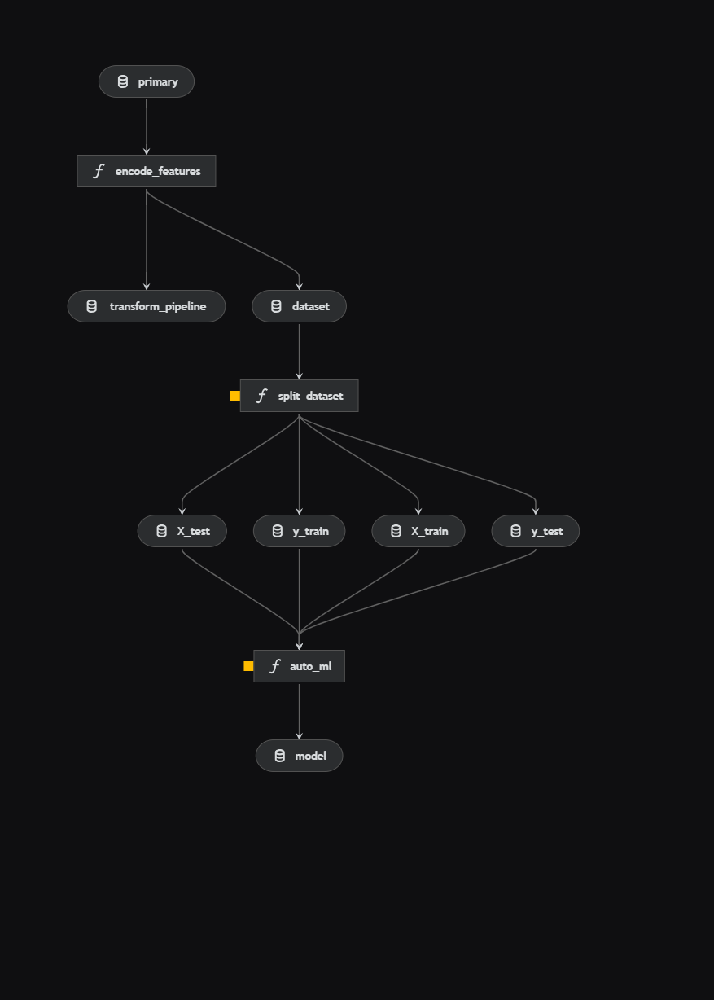
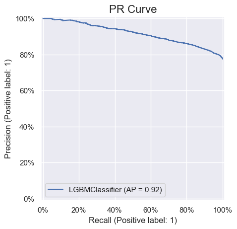
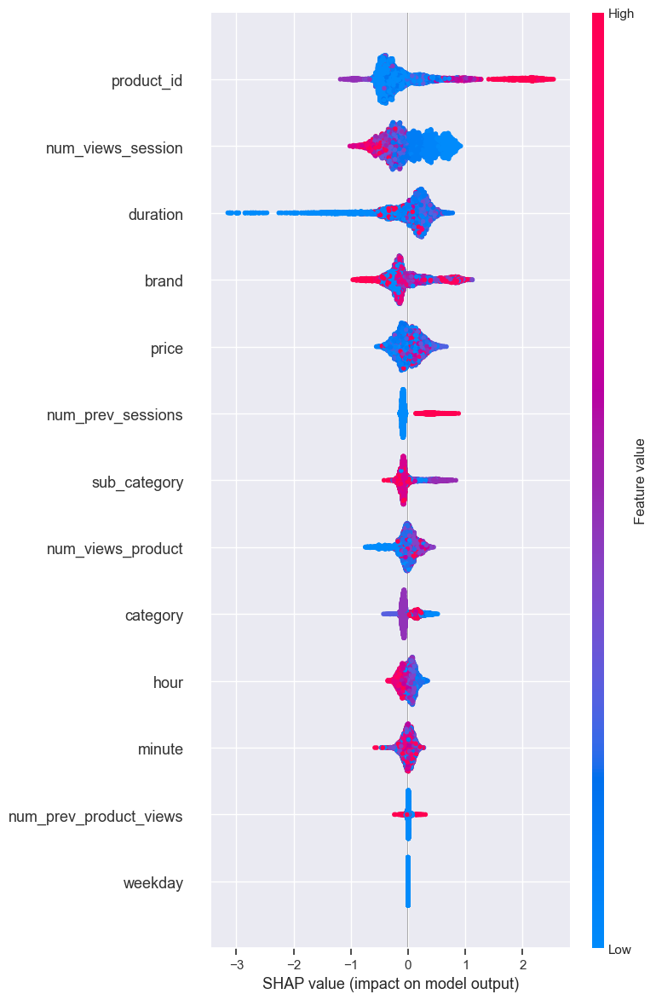
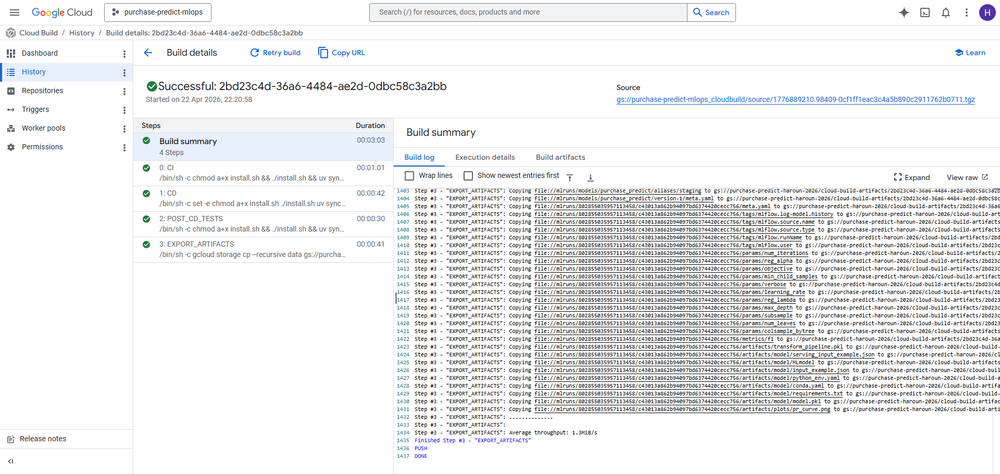

# purchase-predict

Will a visitor buy the product in their cart? A LightGBM classifier answers from the session, the product and the user's history. Around it sit a Kedro pipeline, an MLflow registry, a Flask API in Docker and Cloud Build pipelines to Cloud Run and GKE.



## What it does

- Training table built from one day (1 October 2019) of a public e-commerce log: 1,244,245 events, 190,188 users, 268,737 sessions.
- One row per session and product that reached the cart: 22,971 rows, 13 features, `purchased` target with 78 % positives.
- Hyperopt (TPE) tunes LightGBM on F1 with 4-fold cross-validation; the refit model is logged to MLflow.
- Registers it as `purchase_predict@staging`; the API serves it with its label encoders.
- Cloud Build retrains, tests and redeploys the API on Cloud Run (pre-production) and GKE (production, 2 replicas).

## How it works

```
pipeline/   Kedro: loading -> processing -> training (Hyperopt, LightGBM) -> deployment (MLflow alias)
api/        Flask /predict, loads models:/purchase_predict@staging from MLFLOW_SERVER
deploy/     cloudbuild.pipeline.yaml (train) -> cloudbuild.preprod.yaml (Cloud Run) or cloudbuild.prod.yaml (GKE)
```

## Results

|Model (held-out, threshold 0.5)|F1|Precision|Recall|ROC AUC|
|---|---|---|---|---|
|Notebook model, 5,743 test rows|0.876|0.804|0.962|0.765|
|Best pipeline run, 6,892 test rows|0.873|0.813|0.943|0.763|
|Version 1 `@staging`, served by the API|0.850|0.820|0.883|0.725|

With 78 % positives, always predicting "purchase" already gives F1 0.873, so F1 is not informative; ROC AUC (about 0.76) is the metric to read.

|Precision-recall|SHAP|Cloud Build|
|---|---|---|
||||

## Run it

Python 3.12 and uv; works offline because the primary table is in the repository.

```bash
cd pipeline && uv sync && uv run pytest                        # 6 passed, 2 skipped without a model
uv run kedro run --params automl_max_evals=1                   # registers @staging
cd ../api && cp .env.example .env && uv sync && uv run pytest  # 2 passed
uv run python app.py                                           # http://127.0.0.1:5003
curl -X POST http://127.0.0.1:5003/predict -H "Content-Type: application/json" --data @sample-payload.json
```

Expected answer: `[1,1,1,1,1,1,1,1,1,0]`. `MLFLOW_SERVER` defaults to `api/mlruns`; `../pipeline/mlruns` serves a model you trained. `docker compose up --build` in `api/` serves the same image on port 8080; cloud deployment needs a GCP project, see `deploy/README.md`.

## Limitations

- Only cart items are scored and session features include post-purchase events; a fairer version cuts sessions at the cart and splits by time.
- Hyperopt's cross-validation runs on train and test concatenated, so the test set leaks into the hyper-parameter choice.
- The deployment node aliases the last run, so a one-evaluation model (F1 0.850) serves while a better run (F1 0.873) exists.

MLOps module project, CY Tech, ING3, 2025-2026, team of four: Amine Filali, Hadj Rabearimananana, Haroun Joudi, Mouad Ouad. Notebooks and oral presentation were team work; I wrote most of the implementation in this repository.
