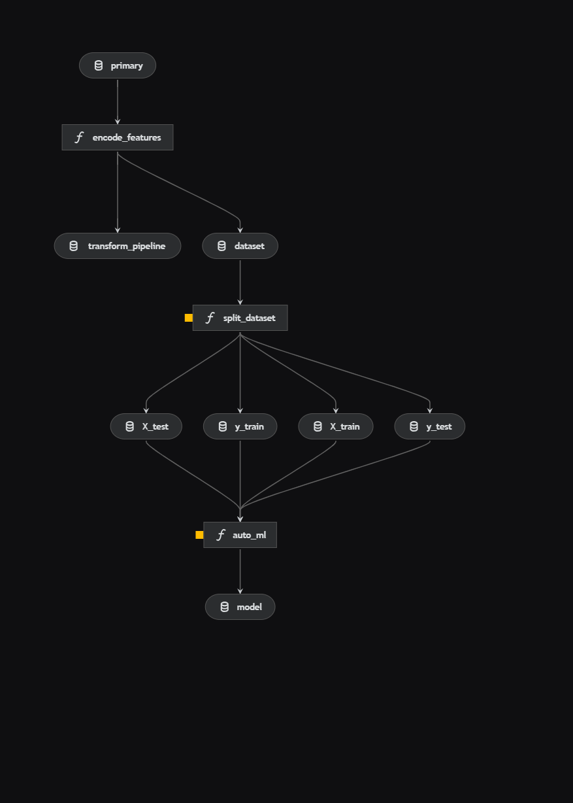
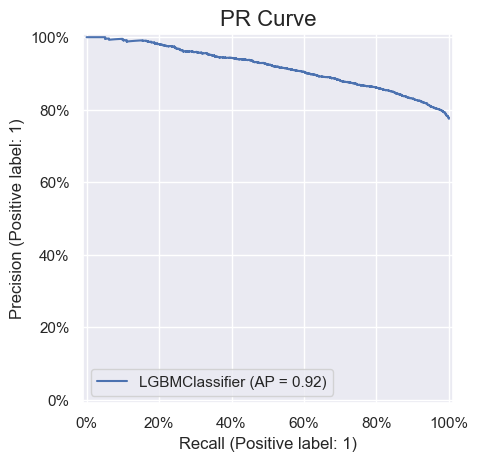
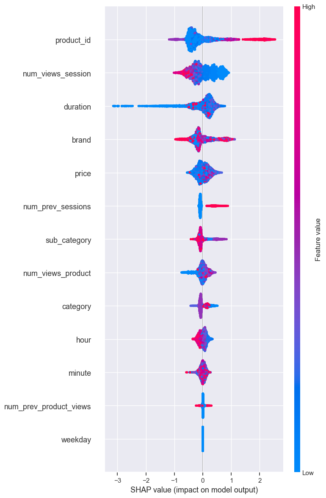
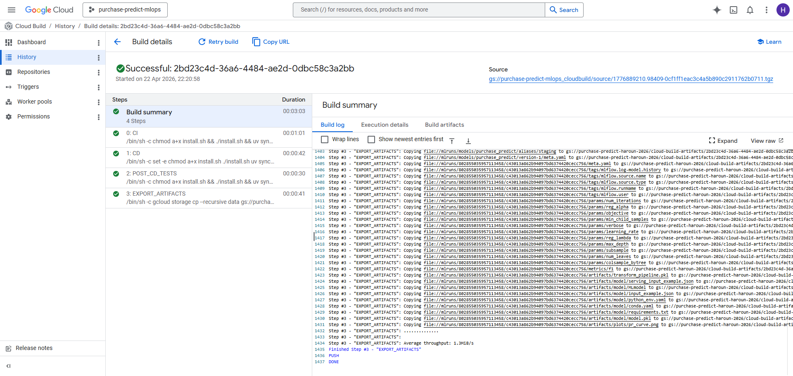

# purchase-predict

Given what a visitor did in an e-commerce session, will they buy the product they put in
their cart? The classifier is a LightGBM model; most of the project is the machinery around
it: a Kedro pipeline with tests (`pipeline/`), MLflow tracking and a model registry, a
Flask API in Docker (`api/`, with a small MLflow store holding the registered model so it
runs out of the box), and Cloud Build pipelines (`deploy/`) that retrain the model and
redeploy the API on Cloud Run (pre-production) and on a GKE cluster (production). MLOps
module project, CY Tech ING3, 2025-2026, team of four: Amine Filali, Hadj Rabearimananana,
Haroun Joudi, Mouad Ouad. The notebooks and the oral presentation were team work; I wrote
most of the implementation in this repository.



## Data and model

The raw file is one day (1 October 2019) of a public e-commerce event log: 1,244,245
`view`, `cart` and `purchase` events from 190,188 users and 268,737 sessions; 97 % of the
events are views and 6 % of the sessions contain a purchase. `scripts/build_primary_dataset.py`
turns that log into one row per (session, product) pair that reached the cart or the
purchase stage: 22,971 rows, a `purchased` target (78 % positives) and 13 features from the
product (id, brand, price, category, sub-category), the session (views, duration, hour,
minute, weekday) and the user's history (previous sessions and product views).

I chose LightGBM because it trains in seconds on this table and copes with label-encoded
categories; the encoders for `brand`, `category` and `sub_category` are saved next to the
model, so the API applies the same transformation. Hyperopt (TPE) tunes learning rate,
iterations, depth, leaves, subsampling and regularisation on F1 with 4-fold cross-validation;
the `training` node refits the best candidate and logs parameters, F1, the precision-recall
curve, encoders and model to MLflow; the `deployment` node registers it as `purchase_predict`
with the alias `staging`.

| Model (held-out split, threshold 0.5) | F1 | Precision | Recall | ROC AUC |
|---|---|---|---|---|
| Notebook model, Hyperopt (5,743 test rows) | 0.876 | 0.804 | 0.962 | 0.765 |
| Best run tracked by the pipeline (6,892 test rows) | 0.873 | 0.813 | 0.943 | 0.763 |
| Registered version 1, `@staging` (1 Hyperopt evaluation, the one the API serves) | 0.850 | 0.820 | 0.883 | 0.725 |

With 78 % positives, predicting "purchase" for every row already gives F1 0.873, so F1 is not
informative here; ROC AUC (about 0.76) and the precision-recall curve are the metrics to look at.




## Running it locally

```
# Windows, Python 3.12, uv (https://docs.astral.sh/uv/). Works offline: the primary table is in the repository.
cd pipeline
uv sync
uv run pytest                                   # 6 passed, 2 skipped until a model exists
uv run kedro run --params automl_max_evals=1    # writes data/ and pipeline/mlruns, registers @staging
cd ../api
cp .env.example .env
uv sync
uv run pytest                                   # 2 passed
uv run python app.py
curl -X POST http://127.0.0.1:5003/predict -H "Content-Type: application/json" --data @sample-payload.json
# [1, 1, 1, 1, 1, 1, 1, 1, 1, 0]
```

The API loads `models:/purchase_predict@staging` from `MLFLOW_SERVER` (`api/mlruns` by
default; `../pipeline/mlruns` serves the model you just trained). `docker compose up --build`
in `api/` builds the same image Cloud Build builds and serves it on port 8080.

## Cloud deployment

The cloud part needs a GCP project and a bucket with the primary table (scripts, order and
IAM roles in `deploy/README.md`). `cloudbuild.pipeline.yaml` runs the unit tests, `kedro run`
and the post-training tests, then exports `data/` and `mlruns/` to GCS. `cloudbuild.preprod.yaml`
adds a child build (`cloudbuild.api.yaml`) that tests the API, builds and pushes the image to
Artifact Registry and redeploys the Cloud Run service; `cloudbuild.prod.yaml` uses
`cloudbuild.gke.yaml` instead, which injects the image tag into `deploy/k8s/deployment.yaml`
(2 replicas, rolling update without surge), applies it with `kubectl` and waits for the
rollout. Screenshots of the builds, the registry and the cluster are in `docs/screenshots`.



## Caveats and next steps

- Only session/product pairs that reached the cart are kept, so the model predicts whether a
  cart item is bought, not whether a visitor buys, and the session features include what
  happens after the purchase; a fair version would cut each session at the cart event and split by time.
- Hyperopt's cross-validation runs on train and test concatenated, so the test set leaks
  into the choice of hyper-parameters; the threshold was never tuned.
- The deployment node aliases whatever run just finished and each Cloud Build starts from an
  empty MLflow store, so a one-evaluation model (F1 0.850) serves in production while a better
  run (F1 0.873) exists; promotion should be gated on the metrics, with a `production` alias.
- MLflow is a file store copied through GCS and baked into the image; a tracking server with a
  GCS artifact store and Cloud Build triggers on push would replace the manual `gcloud builds submit`.
